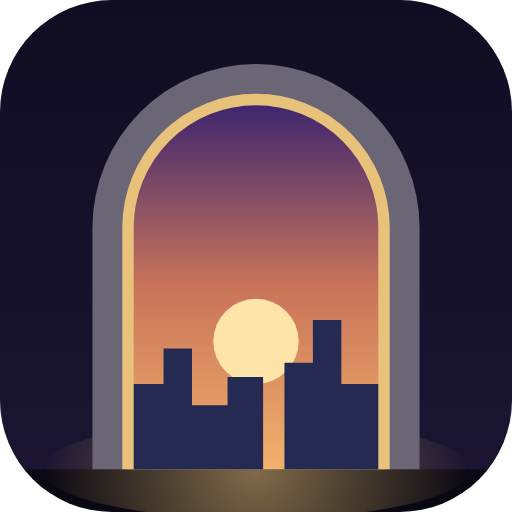
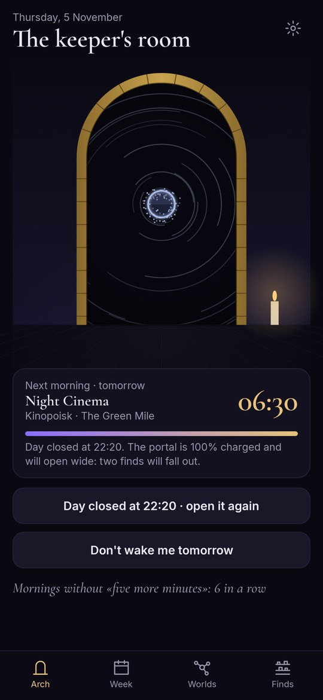
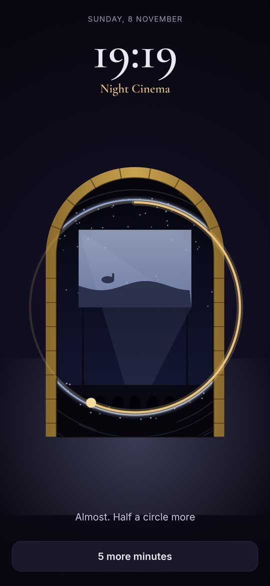
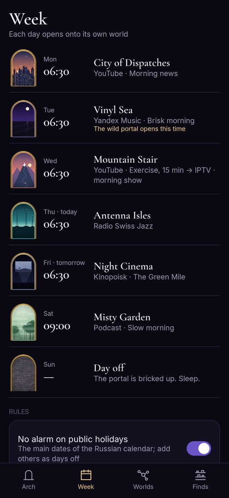
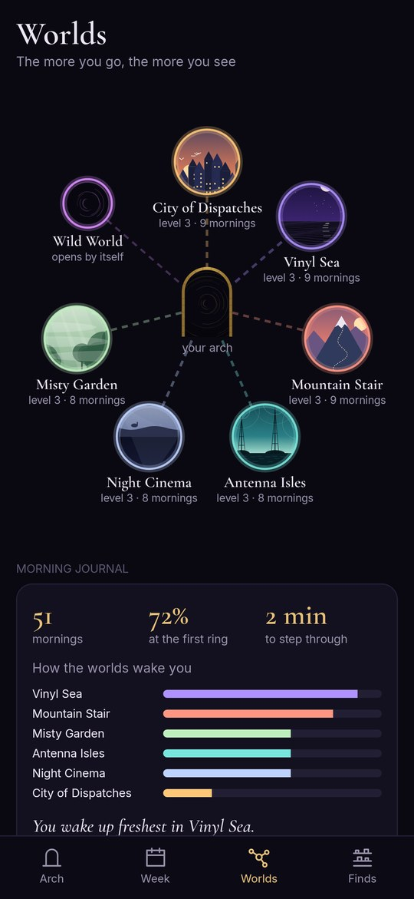

<div align="center">



# Threshold

### An alarm that opens the morning

*Each day of the week gets its own morning: the news on YouTube on Monday, a Yandex Music playlist on Tuesday, the radio on Thursday, a film on Friday. The alarm rings, you trace a circle, step through the portal, and the right app opens by itself. Free, no ads, no account.*

[](https://github.com/bigdevwhale/threshold/actions/workflows/android.yml)
[](https://github.com/bigdevwhale/threshold/releases/latest)


[](LICENSE)

**English** · [Русский](README.ru.md) · [Changelog](CHANGELOG.md)

   

**[Download APK](https://github.com/bigdevwhale/threshold/releases/latest/download/Threshold.apk)** · Android 9+

</div>

---

## A morning for each day

Every day of the week has its own time and its own morning. What comes through:

- **an app** – any installed one;
- **a link** – a particular video, playlist, album or film, opened right in its own app: YouTube, Yandex Music, Spotify, Kinopoisk;
- **the radio**, played by Threshold itself, so the station is the alarm sound.

Steps chain: fifteen minutes of exercise on YouTube, then the morning show. The easiest way to add a link: tap «Share» → Threshold in YouTube or Yandex Music and pick a day.

Music starts by itself: Spotify playlists and Yandex Music albums open already playing, and a YouTube video starts with sound.

## The portal

Each morning a portal opens in the arch of your room, onto another world. Each day has its own: news is the City of Dispatches, music the Vinyl Sea, exercise the Mountain Stair, radio the Antenna Isles, films the Night Cinema, a slow Saturday the Misty Garden.

The alarm is the portal's hum and bells, rising slowly. To stop it, trace a circle with your finger: the portal opens, and you step through. If you'd rather not, a day can be set to «Open at once»: the app comes up by itself and the phone only asks to be unlocked.

## Finds

Something falls out of every world: a dispatch feather, a vinyl shard, a ticket stub. Each world has six finds, two of them rare.

- **Close the day in the evening:** hold the button on the home screen, or tap «Close the day» in the evening reminder. Seven hours' notice and no snoozing open the portal wide: two finds.
- **«Five more minutes»** narrows the portal to a slit: one find after one snooze, none after two.
- **Worlds grow** the more you go there, and residents appear: the postmaster, the projectionist, the mountain goat.
- **The arch's frame** is rebuilt as finds pile up: wood, stone, brass, ice, vine.

## The morning journal

After stepping through, say how waking up went: fresh, so-so or hard. The journal shows how often you got up at the first ring and which world wakes you best, and if Mondays with the news are always hard, it suggests giving that day another world.

## Rules of the week

- Public holidays count as days off (the main dates of the Russian calendar).
- Vacation: no alarm from one date to another.
- «Don't wake me tomorrow» in one tap.
- **The wild portal** once a week brings something from your «someday» list instead: an album, a film, a lecture you keep meaning to get to.
- «Time to go» twenty minutes after stepping through, so the morning's video doesn't eat the whole morning.

## So that it rings

The «Will it ring?» page shows what the phone still has to allow: notifications, the alarm over the lock screen, exact timing, no battery saving. Xiaomi, Redmi and POCO also need Autostart, and on the first morning the phone asks «Allow Threshold to open …?» – choose «Always allow».

## Building

JDK 17+ (Android Studio's bundled JBR works) and the Android SDK.

```bash
git clone https://github.com/bigdevwhale/threshold.git
cd threshold
./gradlew testDebugUnitTest assembleDebug   # app.threshold.dev
./gradlew assembleDebug -Pdemo              # app.threshold.demo: a lived-in week, finds and journal
./gradlew testDebugUnitTest -Prender        # screens into app/build/art
python tools/res.py                         # EN and RU strings from one table
```

Kotlin, Jetpack Compose, DataStore. The worlds, the portal and the finds are drawn in code; the portal's sound is synthesized on the phone.

## Feedback

Settings has «Report a bug» and «Suggest an idea», which open the StillCraft bot in Telegram.

## License

MIT. Fonts Cormorant Garamond (Christian Thalmann) and Inter (Rasmus Andersson), SIL Open Font License. Threshold is part of [StillCraft](https://bigdevwhale.github.io/stillcraft/), a shelf of small free apps.
