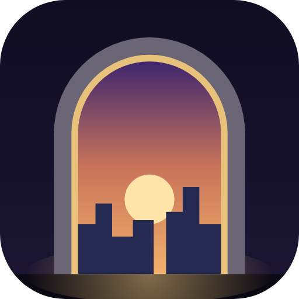
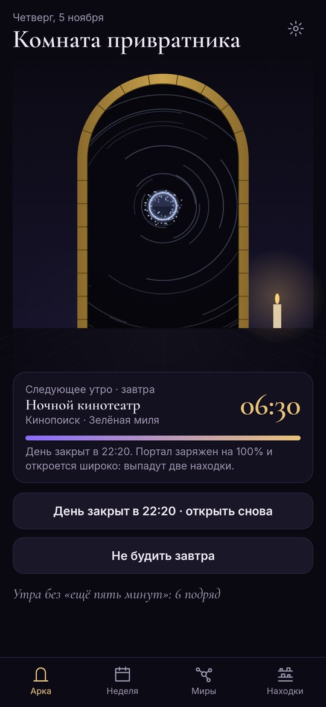
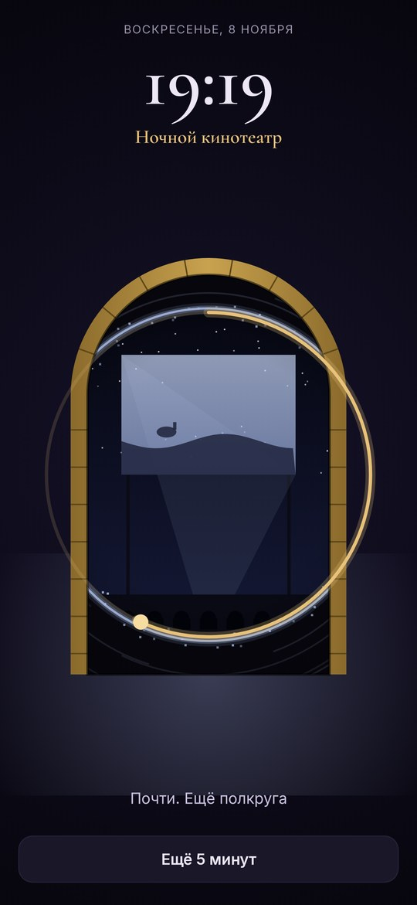
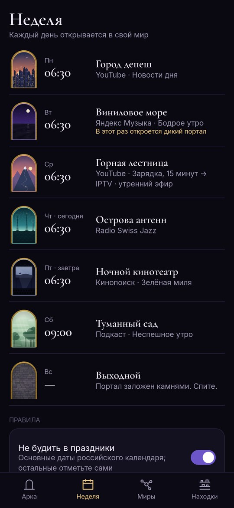
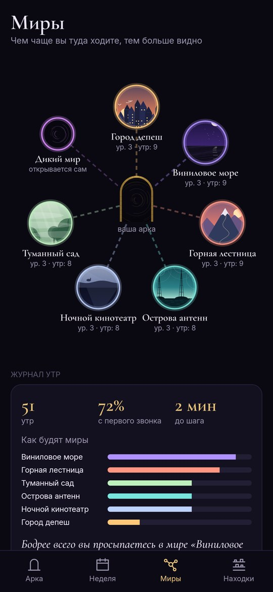

<div align="center">



# Порог

### Умный будильник, который сам запускает нужное приложение

*Утром будильник сам откроет то, что вы выбрали на этот день: в понедельник новости на YouTube, во вторник плейлист в Яндекс Музыке, в четверг радио, в пятницу фильм. Обведите пальцем круг, шагните в портал – и всё уже играет. Бесплатно, без рекламы и регистрации.*

[](https://github.com/bigdevwhale/threshold/actions/workflows/android.yml)
[](https://github.com/bigdevwhale/threshold/releases/latest)


[](LICENSE)

[English](README.md) · **Русский** · [Изменения](CHANGELOG.md)

   

**[Скачать APK](https://github.com/bigdevwhale/threshold/releases/latest/download/Threshold.apk)** · Android 9+

</div>

---

## На каждый день своё

Для каждого дня недели можно выбрать время звонка и то, что откроется утром:

- **приложение** – любое из установленных;
- **ссылка** – конкретное видео, плейлист, альбом или фильм. Она откроется прямо в своём приложении: YouTube, Яндекс Музыке, Spotify, Кинопоиске;
- **радио** – его играет сам «Порог», и эфир становится звонком.

Шаги можно связать в цепочку: пятнадцать минут зарядки на YouTube, потом утренний эфир. Проще всего добавить ссылку так: в YouTube или Яндекс Музыке нажмите «Поделиться» → «Порог» и выберите день.

Музыка начинает играть сама: плейлисты Spotify и альбомы Яндекс Музыки «Порог» открывает сразу на воспроизведении, видео на YouTube тоже запускается со звуком.

## Портал

Каждое утро в арке вашей комнаты открывается портал в другой мир. У каждого дня свой мир: новости – Город депеш, музыка – Виниловое море, зарядка – Горная лестница, радио – Острова антенн, кино – Ночной кинотеатр, неспешное субботнее утро – Туманный сад.

Будильник звонит гулом портала и колокольчиками, громкость нарастает постепенно. Чтобы выключить его, проведите пальцем по кругу: портал раскроется, и останется шагнуть. Если хочется без этого, у дня можно включить «Открывать сразу»: приложение откроется само, телефон только попросит разблокировку.

## Находки

Из каждого мира что-то выпадает: перо депеши, осколок пластинки, корешок билета. В каждом мире шесть находок, две из них редкие.

- **Закройте день вечером.** Удержите кнопку на главном экране или нажмите «Закрыть день» в вечернем напоминании. Если закрыть день за семь часов до будильника и встать с первого звонка, портал откроется широко и выпадут две находки.
- **«Ещё 5 минут».** Портал сузится до щели. После одного откладывания выпадет одна находка, после двух – ни одной.
- **Миры растут.** Чем чаще вы туда ходите, тем выше уровень мира и тем больше в нём жителей: почтмейстер, киномеханик, горный козёл.
- **Рама арки** перестраивается по мере того, как копятся находки: дерево, камень, латунь, лёд, лоза.

## Журнал утр

После шага можно отметить, как проснулись: бодро, так себе или тяжело. Журнал покажет, сколько раз вы встали с первого звонка и какой мир будит лучше всего. А если по понедельникам с новостями утро всегда тяжёлое, подскажет дать этому дню другой мир.

## Правила недели

- Праздники – как выходной (основные даты российского календаря).
- Отпуск: с какого по какое число не будить.
- «Не будить завтра» одним нажатием.
- **Дикий портал** раз в неделю: вместо обычного утра откроется что-то из списка «когда-нибудь» – альбом, фильм, лекция, до которых всё не доходили руки.
- «Пора» через 20 минут после шага, чтобы утреннее видео не съело всё утро.

## Чтобы будильник прозвенел

На странице «Прозвенит ли?» видно, что ещё должен разрешить телефон: уведомления, будильник поверх экрана блокировки, точное время, работу без экономии батареи. На Xiaomi, Redmi и POCO нужно включить автозапуск. Кроме того, в первое утро телефон спросит «Разрешить Порогу открыть…?» – выберите «Всегда разрешать».

## Сборка

Нужны JDK 17+ (подойдёт JBR из Android Studio) и Android SDK.

```bash
git clone https://github.com/bigdevwhale/threshold.git
cd threshold
./gradlew testDebugUnitTest assembleDebug   # app.threshold.dev
./gradlew assembleDebug -Pdemo              # app.threshold.demo: обжитая неделя, находки и журнал
./gradlew testDebugUnitTest -Prender        # экраны в app/build/art
python tools/res.py                         # строки EN и RU из одной таблицы
```

Kotlin, Jetpack Compose, DataStore. Миры, портал и находки нарисованы кодом, звук портала синтезируется на телефоне.

## Обратная связь

В настройках есть кнопки «Сообщить об ошибке» и «Предложить идею», они ведут к боту StillCraft в Telegram.

## Лицензия

MIT. Шрифты Cormorant Garamond (Christian Thalmann) и Inter (Rasmus Andersson), SIL Open Font License. «Порог» входит в [StillCraft](https://bigdevwhale.github.io/stillcraft/) – полку небольших бесплатных приложений.
